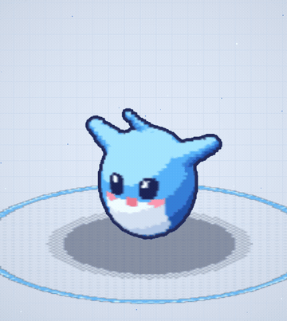
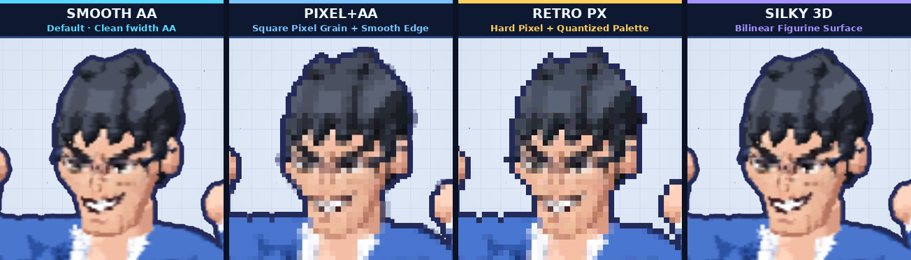
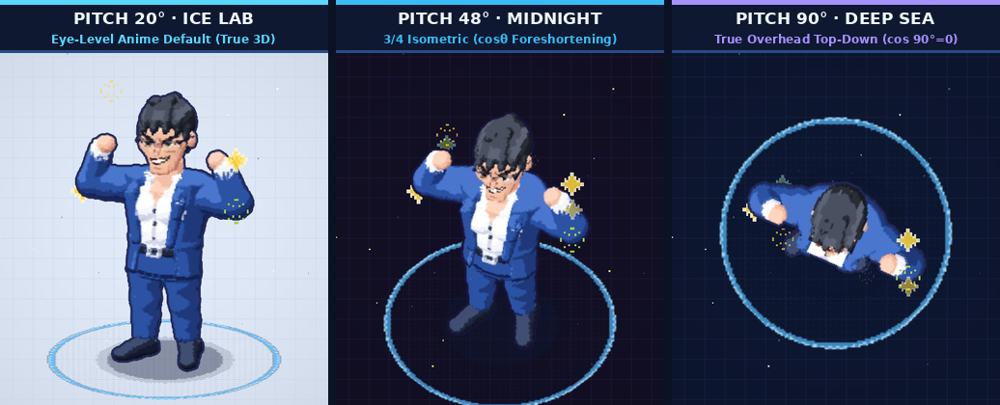
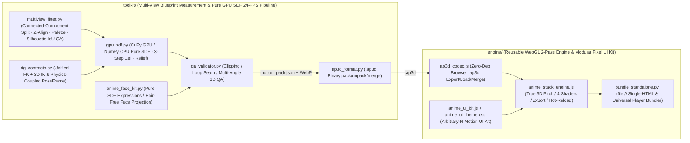

<div align="center">


# Anime Pseudo-3D

**High-Resolution 160-Slice · 24-FPS Anime Pseudo-3D (Sprite-Stacking) Production Skill & Character-Agnostic WebGL 2-Pass Engine**

<p>
  
  
  
  
  
  
  
</p>

<p>
  <a href="./README.md">🇯🇵 日本語</a> &nbsp;|&nbsp;
  <b>🇺🇸 English</b> &nbsp;|&nbsp;
  <a href="./README.zh-CN.md">🇨🇳 简体中文</a>
</p>

</div>

---

A reusable framework and AI agent skill for crafting **smooth 360°-rotatable anime chibi characters** that preserve original artwork facial expressions—complete with **camera-aware Z-sorted 3D orbiting companions**, **overhead thought-bubble meme overlays**, and **3D water/elemental particle attack FX**—bundled into a **zero-dependency, offline `file://` single HTML file**.

---

## Live Demos & Visual Showcase

### 1. Built-in Minimal Demo ([`examples/slime_chibi_demo/`](./examples/slime_chibi_demo/build_demo.py))
Runs directly on `engine/` with **zero engine edits**, driven purely by `motion_pack.json` (builds a self-contained single HTML in ~1.3 seconds).

<table>
  <tr>
    <td align="center" width="33%">
      <br />
      <b>360° Seamless Turntable</b><br />
      <sub>Zero angle quantization · 2x sub-slice interpolation</sub>
    </td>
    <td align="center" width="33%">
      <br />
      <b>3D Companion Z-Sort (BOUNCE)</b><br />
      <sub>3D star companion orbits cleanly behind & in front</sub>
    </td>
    <td align="center" width="33%">
      <br />
      <b>Elemental Slash & 3D FX (SPLASH)</b><br />
      <sub>Crescent slash + 3D spray + floor shockwave ring</sub>
    </td>
  </tr>
</table>

### 2. Four Real-Time WebGL Render Shaders
Switch instantaneously between silky anime anti-aliasing, chunky pixel grain, classic retro hard pixels, and figurine-smooth 3D interpolation.

<p align="center">
  
</p>

### 3. True 3D Orthographic Pitch (`15°–90°`) & 3 Studio Themes
160 stacked 2D slice textures rotate continuously on the GPU with **true 3D orthographic elevation (`y = rot.y · sin θ − z · cos θ`)** and 2× interleaved sub-slice interpolation (320 effective layers)—gliding smoothly from eye-level anime view (`20°`) through 3/4 isometric (`48°`) to true top-down (`90°`) with zero vertical body distortion.

<p align="center">
  
</p>

### 4. Flagship Showcase Built with This Engine ([kuraneko1/deepseek-chan-3d](https://github.com/kuraneko1/deepseek-chan-3d/blob/main/README.en.md))
Full 9-motion × 24-FPS interactive showcases featuring **DeepSeek-chan (Whale Maid)** and **GigaChad DeepSeek CEO (Power Type — running on the unmodified engine)**.

<table>
  <tr>
    <td align="center" width="25%">
      <a href="https://github.com/kuraneko1/deepseek-chan-3d/blob/main/README.en.md">
        
      </a><br />
      <b>DeepSeek-chan</b><br />
      <sub>3D Logo Whale Playtime</sub>
    </td>
    <td align="center" width="25%">
      <a href="https://github.com/kuraneko1/deepseek-chan-3d/blob/main/README.en.md">
        
      </a><br />
      <b>DeepSeek-chan</b><br />
      <sub>Abyssal Vortex 3D FX</sub>
    </td>
    <td align="center" width="25%">
      <a href="https://github.com/kuraneko1/deepseek-chan-3d/blob/main/README.en.md">
        
      </a><br />
      <b>GigaChad CEO</b><br />
      <sub>Double Bicep Flex</sub>
    </td>
    <td align="center" width="25%">
      <a href="https://github.com/kuraneko1/deepseek-chan-3d/blob/main/README.en.md">
        
      </a><br />
      <b>GigaChad CEO</b><br />
      <sub>Boss Aura + 3D Whale</sub>
    </td>
  </tr>
</table>

---

## Credits & Inspiration

The core sprite-stacking (layered 2D slice fake-3D pixel art) inspiration and foundational methodology of this repository are deeply influenced by:

- **[SpriteCook — Sprite stacking for fake 3D pixel art cars and props](https://www.spritecook.ai/blog/sprite-stacking-pixel-art)**
- General sprite-stacking foundation skill: [kuraneko1/sprite-stacking-3d](https://github.com/kuraneko1/sprite-stacking-3d)

---

## 4-Layer Architecture (Multi-View Blueprints · Pure GPU SDF · `.ap3d` Format · Reusable UI & Engine)



---

## Key Features

### 1. Reusable WebGL 2-Pass Engine & Arbitrary-N Motion UI Kit (`engine/`)
- **Modular UI Library (`AnimeStackEngine` + `AnimeUIKit`)**: Decouples the WebGL core (`anime_stack_engine.js`) from the 100% pixel-pure UI component library (`anime_ui_kit.js` + `anime_ui_theme.css`). Mount a complete studio in 1 line (`mountStudioUI()`) or compose individual widgets (`createMotionShelf`, `createPixelSlider`, `createTimelineScrubber`, `createFileIOControls`) in any custom app.
- **Arbitrary-N Animations (`1` to `∞` Motions)**: Scales cleanly from 1 static model to 9, 18, or 50+ motions with dynamic grid sizing, scrollable pixel shelf, optional category filter tabs (`motion.category`), `<` / `>` (`[` / `]` keys) stepping, and live `engine.addMotions()` / `engine.loadScene()` hot-reloading.
- **Portable `.ap3d` Binary Package Format**: Zero-dependency binary container (`AP3D` v1, ~33% smaller than base64). Export, load, or append-merge animations right inside the browser via **`LOAD` / `+MOTION` / `EXPORT`** buttons or **drag-and-drop onto the 3D stage** (hold `Shift` on drop to merge). Ships with a lightweight universal player [`examples/ap3d_player.html`](./examples/ap3d_player.html) (~116 KB).
- **True 3D Orthographic Elevation & 4 Live Shaders**: Continuous 0.001° GPU rotation + true 3D elevation (`y = rot.y · sin θ − z · cos θ`, `PITCH 15°–90°`, default `20°`) + 2× interleaved sub-slices (320 layers) + 4 render modes (`SMOOTH AA`, `PIXEL+AA`, `RETRO PX`, `SILKY 3D`).
- **Multi-Stack Z-Sorting & Declarative FX**: Orbiting 3D companions, thought bubbles, and 3D particle emitters configured purely via JSON.

### 2. Multi-View Blueprint QA & Pure GPU SDF Production Toolkit (`toolkit/`)
- **`multiview_fitter.py` (Blueprint-Only & Zero Body Texture Pasting)**: Splits generated `FRONT / SIDE / BACK / TOP` turnaround sheets using connected-component isolation + shared baseline preservation + interior white-hole clearing, extracts exact anatomical coordinates & clean cel palettes (`sample_clean_palette`), and validates pure SDF sculpts via orthographic Silhouette IoU QA overlays (`qa_3d_fit_overlay.png`, target `>= 72%`). **Never pastes 2D turnaround images as muddy body textures!**
- **`ap3d_format.py`**: Python CLI for `.ap3d` `pack`, `unpack`, `inspect`, and `merge` (append extra animations without re-baking).
- **`gpu_sdf.py` / `anime_face_kit.py` / `rig_contracts.py` / `qa_validator.py` / `record_gif.py`**: Auto CuPy/NumPy pure SDFs (with float32 NaN-safe `safe_sin_pow`, tucked-chin mochi-cheek anime head `sd_anime_head`, 3D `sd_polyline` cords, `sdf_indent_bulge` plush/cloth relief, and 3-step normal cel shading), hair-free face projection, unified FK/IK `PoseFrame`, border clipping guard, and Playwright + FFmpeg GIF capture.

---

## Directory Structure

```text
anime-pseudo-3d/
├── SKILL.md                      # Complete 6-Stage AI Agent Skill SOP
├── README.md / README.en.md / README.zh-CN.md
├── assets/                       # Logo icon, demo GIFs, render-mode & true-3D pitch visual guides
├── engine/
│   ├── anime_stack_engine.js     # Reusable, hot-reloadable WebGL 2-Pass engine
│   ├── anime_ui_kit.js           # Reusable pixel UI component kit (arbitrary-N motions + .ap3d IO)
│   ├── anime_ui_theme.css        # 100% pixel-pure studio CSS theme (Desktop + Mobile)
│   ├── ap3d_codec.js             # Zero-dependency browser .ap3d binary codec
│   ├── viewer_shell.html         # Clean modular HTML shell
│   ├── motion_pack.schema.json   # Declarative motion_pack.json JSON Schema (v1.1)
│   ├── bundle_standalone.py      # Offline single-HTML / .ap3d / universal player bundler
│   └── audit_pixel_build.py      # Modular HTML + CSS + JS pixel-purity auditor
├── toolkit/
│   ├── multiview_fitter.py       # Connected-component splitter, Z-aligner, palette sampler & Silhouette IoU QA
│   ├── ap3d_format.py            # .ap3d binary CLI (pack / unpack / inspect / merge)
│   ├── gpu_sdf.py                # CuPy GPU / NumPy CPU pure 3D SDF primitives, NaN guards & relief helpers
│   ├── anime_face_kit.py         # Hair-free tilted face projection & expression helpers
│   ├── rig_contracts.py          # Unified FK/IK PoseFrame & cyclic motion curves
│   ├── pixel_fx_kit.py           # Pixel FX sprites & 16x16 UI icons
│   ├── qa_validator.py           # Pre-bake math QA + clipping guard + 3D QA sheets
│   └── record_gif.py             # Playwright WebGL → FFmpeg palette-optimized GIF recorder
├── examples/
│   ├── ap3d_player.html          # Lightweight universal drag-and-drop .ap3d player (~116 KB)
│   └── slime_chibi_demo/         # End-to-end minimal demo (standalone HTML + slime-chibi.ap3d)
└── references/
    ├── multiview_3d_reconstruction_guide.md  # Multi-view blueprint prompts & pure-SDF Silhouette IoU QA guide
    ├── anime_model_guide.md                  # Anime-style 3D model design guide
    ├── animation_24fps_guide.md              # 24-FPS rigging, IK & timing guide
    └── webgl_engine_guide.md                 # WebGL engine, AnimeUIKit & .ap3d API reference
```

---

## Quick Start

### 1. Install as an AI Agent Skill (Antigravity / `~/.agents/skills`)
```bash
git clone https://github.com/kuraneko1/anime-pseudo-3d.git ~/projects/anime-pseudo-3d
ln -s ~/projects/anime-pseudo-3d ~/.agents/skills/anime-pseudo-3d
```

### 2. Build the Minimal Demo (Single HTML + `.ap3d`) & Try the Universal Player
```bash
cd ~/projects/anime-pseudo-3d
python3 examples/slime_chibi_demo/build_demo.py
# -> Open examples/slime_chibi_demo/build/slime-chibi-standalone.html,
#    OR open examples/ap3d_player.html and drag-and-drop slime-chibi.ap3d!
```

### 3. Audit, Pack `.ap3d`, Merge Motions & Bundle Single HTML
```bash
python3 engine/audit_pixel_build.py \
  --html engine/viewer_shell.html \
  --css engine/anime_ui_theme.css \
  --js engine/ap3d_codec.js engine/anime_ui_kit.js engine/anime_stack_engine.js

python3 engine/bundle_standalone.py \
  --html engine/viewer_shell.html \
  --js engine/anime_stack_engine.js \
  --pack your_char/motion_pack.json \
  --assets-root your_char \
  --export-ap3d dist/your-char.ap3d \
  --out dist/your-char-standalone.html

# Append extra animations to an existing .ap3d without re-baking
python3 toolkit/ap3d_format.py merge \
  --base dist/your-char.ap3d \
  --extra dist/more-motions.ap3d \
  --out dist/your-char-expanded.ap3d
```

---

## Requirements
- **Python 3.10+** (`numpy`, `pillow`; automatically accelerates with `cupy` when an NVIDIA GPU is available)
- **Browser QA / GIF Recording (Optional)**: `playwright` + Chromium/Chrome + `ffmpeg`
- **Bundled Standalone HTML Output**: Zero dependencies (runs offline in any WebGL-capable browser via `file://`)

---

## License

[MIT License](./LICENSE)
