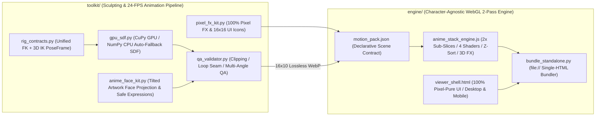

<div align="center">


# Anime Pseudo-3D

**High-Resolution 160-Slice · 24-FPS Anime Pseudo-3D (Sprite-Stacking) Production Skill & Character-Agnostic WebGL 2-Pass Engine**

<p>
  
  
  
  
  
  
  
</p>

<p>
  <a href="./README.md">🇯🇵 日本語</a> &nbsp;|&nbsp;
  <b>🇺🇸 English</b> &nbsp;|&nbsp;
  <a href="./README.zh-CN.md">🇨🇳 简体中文</a>
</p>

</div>

---

A reusable framework and AI agent skill for crafting **smooth 360°-rotatable anime chibi characters** that preserve original artwork facial expressions—complete with **camera-aware Z-sorted 3D orbiting companions**, **overhead thought-bubble meme overlays**, and **3D water/elemental particle attack FX**—bundled into a **zero-dependency, offline `file://` single HTML file**.

---

## Live Demos & Visual Showcase

### 1. Built-in Minimal Demo ([`examples/slime_chibi_demo/`](./examples/slime_chibi_demo/build_demo.py))
Runs directly on `engine/` with **zero engine edits**, driven purely by `motion_pack.json` (builds a self-contained single HTML in ~1.3 seconds).

<table>
  <tr>
    <td align="center" width="33%">
      <br />
      <b>360° Seamless Turntable</b><br />
      <sub>Zero angle quantization · 2x sub-slice interpolation</sub>
    </td>
    <td align="center" width="33%">
      <br />
      <b>3D Companion Z-Sort (BOUNCE)</b><br />
      <sub>3D star companion orbits cleanly behind & in front</sub>
    </td>
    <td align="center" width="33%">
      <br />
      <b>Elemental Slash & 3D FX (SPLASH)</b><br />
      <sub>Crescent slash + 3D spray + floor shockwave ring</sub>
    </td>
  </tr>
</table>

### 2. Four Real-Time WebGL Render Shaders
Switch instantaneously between silky anime anti-aliasing, chunky pixel grain, classic retro hard pixels, and figurine-smooth 3D interpolation.

<p align="center">
  
</p>

### 3. True 3D Orthographic Pitch (`15°–90°`) & 3 Studio Themes
160 stacked 2D slice textures rotate continuously on the GPU with **true 3D orthographic elevation (`y = rot.y · sin θ − z · cos θ`)** and 2× interleaved sub-slice interpolation (320 effective layers)—gliding smoothly from eye-level anime view (`20°`) through 3/4 isometric (`48°`) to true top-down (`90°`) with zero vertical body distortion.

<p align="center">
  
</p>

### 4. Flagship Showcase Built with This Engine ([kuraneko1/deepseek-chan-3d](https://github.com/kuraneko1/deepseek-chan-3d/blob/main/README.en.md))
Full 9-motion × 24-FPS interactive showcases featuring **DeepSeek-chan (Whale Maid)** and **GigaChad DeepSeek CEO (Power Type — running on the unmodified engine)**.

<table>
  <tr>
    <td align="center" width="25%">
      <a href="https://github.com/kuraneko1/deepseek-chan-3d/blob/main/README.en.md">
        
      </a><br />
      <b>DeepSeek-chan</b><br />
      <sub>3D Logo Whale Playtime</sub>
    </td>
    <td align="center" width="25%">
      <a href="https://github.com/kuraneko1/deepseek-chan-3d/blob/main/README.en.md">
        
      </a><br />
      <b>DeepSeek-chan</b><br />
      <sub>Abyssal Vortex 3D FX</sub>
    </td>
    <td align="center" width="25%">
      <a href="https://github.com/kuraneko1/deepseek-chan-3d/blob/main/README.en.md">
        
      </a><br />
      <b>GigaChad CEO</b><br />
      <sub>Double Bicep Flex</sub>
    </td>
    <td align="center" width="25%">
      <a href="https://github.com/kuraneko1/deepseek-chan-3d/blob/main/README.en.md">
        
      </a><br />
      <b>GigaChad CEO</b><br />
      <sub>Boss Aura + 3D Whale</sub>
    </td>
  </tr>
</table>

---

## Credits & Inspiration

The core sprite-stacking (layered 2D slice fake-3D pixel art) inspiration and foundational methodology of this repository are deeply influenced by:

- **[SpriteCook — Sprite stacking for fake 3D pixel art cars and props](https://www.spritecook.ai/blog/sprite-stacking-pixel-art)**
- General sprite-stacking foundation skill: [kuraneko1/sprite-stacking-3d](https://github.com/kuraneko1/sprite-stacking-3d)

---

## Decoupled Architecture (Model Production vs. WebGL Engine)



---

## Key Features

### 1. Character-Agnostic, Data-Driven WebGL 2-Pass Engine (`engine/`)
- **Zero-Flicker Pipeline**: Continuous 0.001° GPU rotation without angle quantization + 2× interleaved sub-slice interpolation (320 effective slices) + 2× supersampled offscreen FBO.
- **4 Real-Time Render Modes**:
  - `SMOOTH AA` *(default)*: Opaque-texel color normalization + `fwidth` subpixel boundary AA (zero dark fringe bleeding).
  - `PIXEL+AA`: Crisp square pixel dots with smooth antialiased outer edges (adjustable `DOT SIZE`).
  - `RETRO PX`: Classic hard-edge pixels + 4-way stepped pixel outline + retro color quantization.
  - `SILKY 3D`: Smooth bilinear figurine-style surface rendering.
- **Anime-Ready Defaults & True 3D Elevation**: Ships tuned with `PITCH 20°` (`sin θ ≈ 0.35` with exact `cos θ` vertical foreshortening), `ICE LAB` studio theme, and `SMOOTH AA`.
- **Multi-Stack 3D Depth Z-Sorting**: Automatically sorts orbiting 3D companion models (rendered to a second FBO) and 3D particle emitters cleanly behind or in front of the hero character at every camera angle.
- **Declarative `motion_pack.json`**: Define motions, orbiting 3D companions, overhead thought-bubble memes, and 3D particle emitters (`sparkle_perimeter`, `orbit_trail`, `burst_above`, `forward_slash_fan`, `helix_vortex`, `floor_wave_rings`) purely in JSON—no engine JS modifications required.
- **24-Frame Bullet-Time Timeline**: Pause and scrub any frame while orbiting 360° around slashes, shockwaves, and 3D companions.

### 2. Anime 3D Production Toolkit (`toolkit/`)
- **`gpu_sdf.py`**: Auto-detects CuPy (NVIDIA GPU) with seamless NumPy CPU fallback for fast 3D SDF sculpting and 3-step anime cel-shading.
- **`anime_face_kit.py`**: Extracts artwork faces, projects them cleanly onto the sculpted head at eye-level tilt, and provides halo-free expression painting helpers.
- **`rig_contracts.py`**: Unified `PoseFrame` dataclass combining FK rotations with 3D IK targets, volume-preserving `sx` squash-and-stretch, and phase-lagged secondary springs.
- **`qa_validator.py` & `record_gif.py`**: Mathematical loop-seam continuity checks, full-frame border clipping assertions, multi-angle 3D QA sheet renderer, and deterministic Playwright + FFmpeg GIF capture.

---

## Directory Structure

```text
anime-pseudo-3d/
├── SKILL.md                      # AI Agent Skill definition (Antigravity / OpenClaude compatible)
├── README.md / README.en.md / README.zh-CN.md
├── assets/                       # Logo icon, demo GIFs, render-mode & slice-spread visual guides
├── engine/
│   ├── anime_stack_engine.js     # Character-agnostic WebGL 2-Pass engine
│   ├── viewer_shell.html         # 100% pixel-pure UI shell (Desktop + Mobile)
│   ├── motion_pack.schema.json   # Declarative motion_pack.json JSON Schema
│   ├── bundle_standalone.py      # Offline file:// single-HTML bundler
│   └── audit_pixel_build.py      # Pixel-purity static auditor
├── toolkit/
│   ├── gpu_sdf.py                # CuPy GPU / NumPy CPU 3D SDF primitives
│   ├── anime_face_kit.py         # Tilted artwork face projection & expression helpers
│   ├── rig_contracts.py          # Unified FK/IK PoseFrame & cyclic motion curves
│   ├── pixel_fx_kit.py           # Pixel FX sprites (droplet/bubble/slash/ring) & 16x16 icons
│   ├── qa_validator.py           # Pre-bake math QA + clipping guard + 3D QA sheets
│   └── record_gif.py             # Playwright WebGL → FFmpeg palette-optimized GIF recorder
├── examples/
│   └── slime_chibi_demo/         # Minimal end-to-end demo (chibi + 3D star companion + water FX)
└── references/
    ├── anime_model_guide.md      # Anime-style 3D model design guide
    ├── animation_24fps_guide.md  # 24-FPS rigging, IK & timing guide
    └── webgl_engine_guide.md     # WebGL engine & motion_pack.json reference
```

---

## Quick Start

### 1. Install as an AI Agent Skill (Antigravity / `~/.agents/skills`)
```bash
git clone https://github.com/kuraneko1/anime-pseudo-3d.git ~/projects/anime-pseudo-3d
ln -s ~/projects/anime-pseudo-3d ~/.agents/skills/anime-pseudo-3d
```

### 2. Build & Run the Minimal Demo
```bash
cd ~/projects/anime-pseudo-3d
python3 examples/slime_chibi_demo/build_demo.py
# -> Open examples/slime_chibi_demo/build/slime-chibi-standalone.html in any modern browser!
```

### 3. Run Pixel-Purity Audit & Bundle Your Own Single HTML
```bash
python3 engine/audit_pixel_build.py \
  --html engine/viewer_shell.html \
  --js engine/anime_stack_engine.js

python3 engine/bundle_standalone.py \
  --html engine/viewer_shell.html \
  --js engine/anime_stack_engine.js \
  --pack your_char/motion_pack.json \
  --assets-root your_char \
  --out dist/your-char-standalone.html
```

---

## Requirements
- **Python 3.10+** (`numpy`, `pillow`; automatically accelerates with `cupy` when an NVIDIA GPU is available)
- **Browser QA / GIF Recording (Optional)**: `playwright` + Chromium/Chrome + `ffmpeg`
- **Bundled Standalone HTML Output**: Zero dependencies (runs offline in any WebGL-capable browser via `file://`)

---

## License

[MIT License](./LICENSE)
