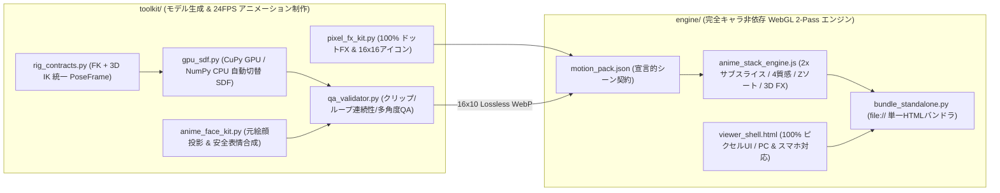

<div align="center">


# Anime Pseudo-3D

**高精細 160 層 × 24 FPS アニメ調疑似 3D（スプライトスタッキング）制作スキル ＆ キャラ非依存 WebGL 2-Pass 表示エンジン**

<p>
  
  
  
  
  
  
  
</p>

<p>
  <b>🇯🇵 日本語</b> &nbsp;|&nbsp;
  <a href="./README.en.md">🇺🇸 English</a> &nbsp;|&nbsp;
  <a href="./README.zh-CN.md">🇨🇳 简体中文</a>
</p>

</div>

---

元イラストの顔周り・表情を崩さず **360° 滑らかに回転**させ、**3D 相棒キャラの前後 Z ソート**、**頭上の吹き出しミーム演出**、**3D 海／属性パーティクル攻撃エフェクト** までを、外部通信ゼロの単一 HTML ファイルとして出力できる汎用フレームワーク＆ AI エージェントスキルです。

---

## デモギャラリー（Live Demos）

### 1. 同梱ミニマルデモ（[`examples/slime_chibi_demo/`](./examples/slime_chibi_demo/build_demo.py)）
`engine/` を **1 行も編集せず** `motion_pack.json` だけで駆動する動作確認用デモ（コマンド 1 本で約 1.3 秒で単一 HTML を生成）。

<table>
  <tr>
    <td align="center" width="33%">
      <br />
      <b>360° シームレス回転</b><br />
      <sub>角度量子化ゼロ・2x サブスライス補間</sub>
    </td>
    <td align="center" width="33%">
      <br />
      <b>3D 相棒 Z ソート（BOUNCE）</b><br />
      <sub>星型 3D 相棒がカメラ角に応じ前後を周回</sub>
    </td>
    <td align="center" width="33%">
      <br />
      <b>属性斬撃＆3D FX（SPLASH）</b><br />
      <sub>三日月斬撃＋3D 飛沫＋床衝撃波リング</sub>
    </td>
  </tr>
</table>

### 2. 4 種類のリアルタイム WebGL 質感シェーダー
ボタン 1 つでアニメ調滑らか描画から王道ドット絵・フィギュア調までリアルタイムに切替可能。

<p align="center">
  
</p>

### 3. リアルタイム視点ピッチ（SQUASH）＆ 3 スタジオテーマ
160 枚の 2D スライス層を GPU 上で連続回転・2 倍インターリーブ補間（計 320 層）することで、アイレベル寄りのアニメ視点（`0.35`）から 3/4 アイソメトリック・真上トップダウン視点（`1.00`）までシームレスに連続変化。3 種類の背景テーマも即時切替できます。

<p align="center">
  
</p>

### 4. 本エンジン採用ショーケース（[kuraneko1/deepseek-chan-3d](https://github.com/kuraneko1/deepseek-chan-3d)）
**DeepSeek ちゃん（クジラメイド）** および **ムキムキ DeepSeek CEO（パワータイプ・エンジン完全無改造）** の 9 モーション × 24 FPS 実作デモを公開中です。

<table>
  <tr>
    <td align="center" width="25%">
      <a href="https://github.com/kuraneko1/deepseek-chan-3d">
        
      </a><br />
      <b>DeepSeek ちゃん</b><br />
      <sub>3D クジラじゃれ合い</sub>
    </td>
    <td align="center" width="25%">
      <a href="https://github.com/kuraneko1/deepseek-chan-3d">
        
      </a><br />
      <b>DeepSeek ちゃん</b><br />
      <sub>深海大渦巻き 3D FX</sub>
    </td>
    <td align="center" width="25%">
      <a href="https://github.com/kuraneko1/deepseek-chan-3d">
        
      </a><br />
      <b>ムキムキ CEO</b><br />
      <sub>ダブルバイセップス</sub>
    </td>
    <td align="center" width="25%">
      <a href="https://github.com/kuraneko1/deepseek-chan-3d">
        
      </a><br />
      <b>ムキムキ CEO</b><br />
      <sub>覚醒オーラ＋3D クジラ</sub>
    </td>
  </tr>
</table>

---

## クレジット・影響を受けた技術（Credits & Inspiration）

本リポジトリのスプライトスタッキング（積層スライスによる疑似 3D ピクセルアート）の基本発想および制作手法は、以下の記事から多大なる影響を受けています。

- **[SpriteCook — Sprite stacking for fake 3D pixel art cars and props](https://www.spritecook.ai/blog/sprite-stacking-pixel-art)**
- 汎用スプライトスタッキング基盤スキル: [kuraneko1/sprite-stacking-3d](https://github.com/kuraneko1/sprite-stacking-3d)

---

## アーキテクチャ（モデル制作・アニメーション・表示エンジンの分離）



---

## 主な特徴

### 1. キャラ非依存・データ駆動 WebGL 2-Pass 表示エンジン（`engine/`）
- **ゼロ・チラつき設計**: 角度量子化なしの連続 0.001° GPU 回転 ＋ 2x インターリーブ・サブスライス（320 層自動補間）＋ 2x スーパーサンプリング FBO。
- **4 種類のリアルタイム質感モード**:
  - `SMOOTH AA`（デフォルト）: 不透明テクセル正規化＋`fwidth` サブピクセル境界 AA（黒フチ滲みゼロ）
  - `PIXEL+AA`: 正方形ドット粒感＋滑らか境界 AA（`DOT SIZE` 調整対応）
  - `RETRO PX`: ハードエッジドット＋4 方向階段輪郭＋カラー量子化
  - `SILKY 3D`: フィギュア風の滑らかバイリニア補間
- **アニメ映え初期設定**: `SQUASH 0.35`（アイレベル寄り正面視点）・`ICE LAB`（明るいスタジオ背景）・`SMOOTH AA` を標準設定。
- **複数 3D スタック前後 Z ソート**: 主役キャラの周囲を泳ぐ 3D 相棒モデル（第 2 FBO）や 3D パーティクルを、カメラ角度に応じて自動でキャラの後ろ／前面へ正確に前後ソート。
- **宣言的 `motion_pack.json`**: モーション一覧・3D 相棒軌道・吹き出しオーバーレイ・3D パーティクル（`sparkle_perimeter` / `orbit_trail` / `burst_above` / `forward_slash_fan` / `helix_vortex` / `floor_wave_rings`）を JSON で定義するだけでエンジン無改造で動作。
- **24 コマ・バレットタイムタイムライン**: 一時停止＆スクラブしながら 360° 回転させて攻撃エフェクトや 3D 相棒を観察可能。

### 2. アニメ調 3D 制作ツールキット（`toolkit/`）
- **`gpu_sdf.py`**: CuPy (NVIDIA GPU) を自動検出し、GPU なし環境では NumPy へ自動フォールバックする 3D SDF プリミティブ＆セルシェーディング群。
- **`anime_face_kit.py`**: 元イラストからの顔抽出・斜め投影・暖色肌ハローを絶対に起こさない表情ペイントヘルパー。
- **`rig_contracts.py`**: FK 角度制御と 3D 座標 IK を 1 つに統合した `PoseFrame` 契約・体積保存 `sx`・ばね遅延周期曲線。
- **`qa_validator.py` & `record_gif.py`**: ループ始終端の連続性検証、全フレーム境界クリッピング検査、多角度 3D QA シート出力、Playwright + FFmpeg による高画質 GIF 録画。

---

## ディレクトリ構成

```text
anime-pseudo-3d/
├── SKILL.md                      # AI エージェント向けスキル定義 (Antigravity / OpenClaude 互換)
├── README.md / README.en.md / README.zh-CN.md
├── assets/                       # ロゴアイコン・デモ GIF・質感＆スライス展開比較画像
├── engine/
│   ├── anime_stack_engine.js     # キャラ非依存 WebGL 2-Pass エンジン本体
│   ├── viewer_shell.html         # 100% ピクセル純度 UI シェル (Desktop + Mobile)
│   ├── motion_pack.schema.json   # motion_pack.json 仕様スキーマ
│   ├── bundle_standalone.py      # 単一 HTML バンドラ (file:// 直開き対応)
│   └── audit_pixel_build.py      # ピクセル純度チェッカー
├── toolkit/
│   ├── gpu_sdf.py                # CuPy GPU / NumPy CPU 3D SDF プリミティブ
│   ├── anime_face_kit.py         # 斜め顔投影 & 表情合成ヘルパー
│   ├── rig_contracts.py          # FK/IK 統一 PoseFrame & 周期曲線
│   ├── pixel_fx_kit.py           # ドット FX・水滴/泡/斬撃/水紋・16x16 アイコン生成
│   ├── qa_validator.py           # 事前数理 QA + クリップ検査 + 3D QA シート
│   └── record_gif.py             # Playwright WebGL → FFmpeg 最適化 GIF 録画
├── examples/
│   └── slime_chibi_demo/         # 最小構成の動作確認デモ（キャラ+3D相棒+水FX）
└── references/
    ├── anime_model_guide.md      # アニメ調モデル設計ガイド
    ├── animation_24fps_guide.md  # 24 FPS モーション & IK ガイド
    └── webgl_engine_guide.md     # WebGL エンジン & motion_pack.json リファレンス
```

---

## クイックスタート

### 1. スキルとしてインストール（Antigravity / `~/.agents/skills`）
```bash
git clone https://github.com/kuraneko1/anime-pseudo-3d.git ~/projects/anime-pseudo-3d
ln -s ~/projects/anime-pseudo-3d ~/.agents/skills/anime-pseudo-3d
```

### 2. 最小デモをビルドして動作確認
```bash
cd ~/projects/anime-pseudo-3d
python3 examples/slime_chibi_demo/build_demo.py
# -> examples/slime_chibi_demo/build/slime-chibi-standalone.html をブラウザで開くだけ！
```

### 3. ピクセル純度チェック & 単一 HTML バンドル
```bash
python3 engine/audit_pixel_build.py \
  --html engine/viewer_shell.html \
  --js engine/anime_stack_engine.js

python3 engine/bundle_standalone.py \
  --html engine/viewer_shell.html \
  --js engine/anime_stack_engine.js \
  --pack your_char/motion_pack.json \
  --assets-root your_char \
  --out dist/your-char-standalone.html
```

---

## 依存環境
- **Python 3.10+** (`numpy`, `pillow`; NVIDIA GPU 高速ベイク時は `cupy` 自動利用)
- **ブラウザ検証 / GIF 録画（任意）**: `playwright` + Chromium/Chrome + `ffmpeg`
- **出力された単一 HTML**: 依存ゼロ（WebGL 対応モダンブラウザのみで完結・`file://` 直開き対応）

---

## License

[MIT License](./LICENSE)
