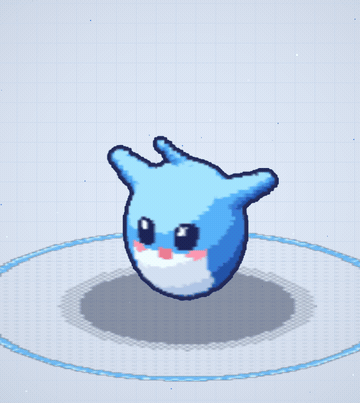
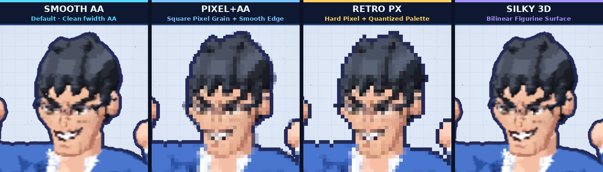
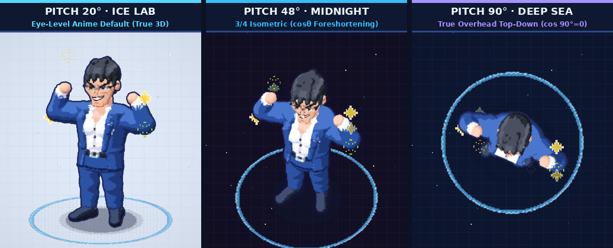
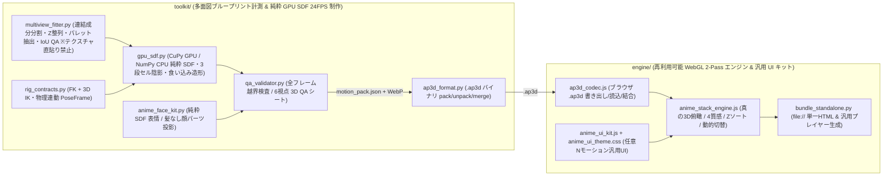

<div align="center">


# Anime Pseudo-3D

**高精細 160 層 × 24 FPS アニメ調疑似 3D（スプライトスタッキング）制作スキル ＆ キャラ非依存 WebGL 2-Pass 表示エンジン**

<p>
  
  
  
  
  
  
  
</p>

<p>
  <b>🇯🇵 日本語</b> &nbsp;|&nbsp;
  <a href="./README.en.md">🇺🇸 English</a> &nbsp;|&nbsp;
  <a href="./README.zh-CN.md">🇨🇳 简体中文</a>
</p>

</div>

---

元イラストの顔周り・表情を崩さず **360° 滑らかに回転**させ、**3D 相棒キャラの前後 Z ソート**、**頭上の吹き出しミーム演出**、**3D 海／属性パーティクル攻撃エフェクト** までを、外部通信ゼロの単一 HTML ファイルとして出力できる汎用フレームワーク＆ AI エージェントスキルです。

---

## デモギャラリー（Live Demos）

### 1. 同梱ミニマルデモ（[`examples/slime_chibi_demo/`](./examples/slime_chibi_demo/build_demo.py)）
`engine/` を **1 行も編集せず** `motion_pack.json` だけで駆動する動作確認用デモ（コマンド 1 本で約 1.3 秒で単一 HTML を生成）。

<table>
  <tr>
    <td align="center" width="33%">
      <br />
      <b>360° シームレス回転</b><br />
      <sub>角度量子化ゼロ・2x サブスライス補間</sub>
    </td>
    <td align="center" width="33%">
      <br />
      <b>3D 相棒 Z ソート（BOUNCE）</b><br />
      <sub>星型 3D 相棒がカメラ角に応じ前後を周回</sub>
    </td>
    <td align="center" width="33%">
      <br />
      <b>属性斬撃＆3D FX（SPLASH）</b><br />
      <sub>三日月斬撃＋3D 飛沫＋床衝撃波リング</sub>
    </td>
  </tr>
</table>

### 2. 4 種類のリアルタイム WebGL 質感シェーダー
ボタン 1 つでアニメ調滑らか描画から王道ドット絵・フィギュア調までリアルタイムに切替可能。

<p align="center">
  
</p>

### 3. 真の 3D 正射影ピッチ（`PITCH 15°〜90°`）＆ 3 スタジオテーマ
160 枚の 2D スライス層を GPU 上で連続回転し、**真の 3D 正射影（`y = rot.y · sin(θ) − z · cos(θ)`）** と 2 倍インターリーブ補間（計 320 層）で投影。アイレベル寄りのアニメ視点（`20°`）から 3/4 アイソメトリック（`48°`）、真上トップダウン視点（`90°`）までボディが伸びずに自然な立体感を維持します。

<p align="center">
  
</p>

### 4. 本エンジン採用ショーケース（[kuraneko1/deepseek-chan-3d](https://github.com/kuraneko1/deepseek-chan-3d)）
**DeepSeek ちゃん（クジラメイド）** および **ムキムキ DeepSeek CEO（パワータイプ・エンジン完全無改造）** の 9 モーション × 24 FPS 実作デモを公開中です。

<table>
  <tr>
    <td align="center" width="25%">
      <a href="https://github.com/kuraneko1/deepseek-chan-3d">
        
      </a><br />
      <b>DeepSeek ちゃん</b><br />
      <sub>3D クジラじゃれ合い</sub>
    </td>
    <td align="center" width="25%">
      <a href="https://github.com/kuraneko1/deepseek-chan-3d">
        
      </a><br />
      <b>DeepSeek ちゃん</b><br />
      <sub>深海大渦巻き 3D FX</sub>
    </td>
    <td align="center" width="25%">
      <a href="https://github.com/kuraneko1/deepseek-chan-3d">
        
      </a><br />
      <b>ムキムキ CEO</b><br />
      <sub>ダブルバイセップス</sub>
    </td>
    <td align="center" width="25%">
      <a href="https://github.com/kuraneko1/deepseek-chan-3d">
        
      </a><br />
      <b>ムキムキ CEO</b><br />
      <sub>覚醒オーラ＋3D クジラ</sub>
    </td>
  </tr>
</table>

---

## クレジット・影響を受けた技術（Credits & Inspiration）

本リポジトリのスプライトスタッキング（積層スライスによる疑似 3D ピクセルアート）の基本発想および制作手法は、以下の記事から多大なる影響を受けています。

- **[SpriteCook — Sprite stacking for fake 3D pixel art cars and props](https://www.spritecook.ai/blog/sprite-stacking-pixel-art)**
- 汎用スプライトスタッキング基盤スキル: [kuraneko1/sprite-stacking-3d](https://github.com/kuraneko1/sprite-stacking-3d)

---

## アーキテクチャ（4 層分離：多面図設計図・純粋 GPU SDF 制作・`.ap3d` 形式・再利用 UI ＆ WebGL エンジン）



---

## 主な特徴

### 1. 再利用可能 WebGL 2-Pass エンジン ＆ 任意 N モーション汎用 UI（`engine/`）
- **再利用可能なコンポーネント設計（`AnimeStackEngine` + `AnimeUIKit`）**: WebGL コア（`anime_stack_engine.js`）と 100% ピクセル純度 UI コンポーネント（`anime_ui_kit.js` / `anime_ui_theme.css`）を分離。自分の Web アプリやゲームに `mountStudioUI()` 1 行、または個別ウィジェット（スライダー・タイムライン・モーション棚・`.ap3d` ファイル IO）単位で組み込めます。
- **アニメーション個数無制限（1〜∞ モーション対応）**: 静止モデル（1 個）から 9 個・18 個・50 個以上まで対応。カテゴリフィルタタブ（`motion.category`）、スクロール対応ピクセル棚、`<` / `>`（`[` / `]` キー）送り、実行時 `engine.addMotions()` / `engine.loadScene()` ホットリロードに対応。
- **独自ポータブル形式 `.ap3d` の書き出し・読込・結合**: 外部 ZIP ライブラリ不要の独自バイナリコンテナ（`AP3D` v1、base64 比約 33% 軽量）。ブラウザ上の **`LOAD` / `+MOTION` / `EXPORT`** ボタンや **ステージへのドラッグ＆ドロップ** でキャラ切替・モーション追加結合・書き出しがオフライン完結します。同梱の軽量ユニバーサルプレイヤー [`examples/ap3d_player.html`](./examples/ap3d_player.html)（約 116 KB）から任意の `.ap3d` を即再生可能。
- **真の 3D 正射影＆4 質感シェーダー**: 角度量子化ゼロの連続 0.001° GPU 回転 ＋ 真の 3D 正射影（`y = rot.y · sin θ − z · cos θ`、`PITCH 15°〜90°`・初期値 `20°`）＋ 2x インターリーブ補間（320 層）＋ 4 質感モード（`SMOOTH AA` / `PIXEL+AA` / `RETRO PX` / `SILKY 3D`）。
- **複数 3D スタック前後 Z ソート & 宣言的 FX**: 3D 相棒モデル・吹き出し・3D パーティクルを JSON 定義のみでエンジン無改造駆動。

### 2. 多面図ブループリント計測 ＆ 純粋 GPU SDF 制作ツールキット（`toolkit/`）
- **`multiview_fitter.py`（ブループリント専用・テクスチャ直貼り禁止設計）**: 画像生成で作った `FRONT / SIDE / BACK / TOP` 三面図シートを連結成分ベースで安全分割し、共通ベースライン整列・囲まれ白抜き穴除去・クリーンなセル塗りパレット抽出（`sample_clean_palette`）・シルエット IoU 自動 QA（`qa_3d_fit_overlay.png`、目標 `≥ 72%`）を実行。2D 線画が滲む**画像テクスチャ直貼りは行わず**、純粋な 3D SDF 造形の設計図・検査基準として活用します。
- **`ap3d_format.py`**: Python CLI で `.ap3d` の `pack` / `unpack` / `inspect` / `merge`（既存キャラへ新モーションを再ベイクなしで結合）に対応。
- **`gpu_sdf.py` / `anime_face_kit.py` / `rig_contracts.py` / `qa_validator.py` / `record_gif.py`**: CuPy GPU / NumPy CPU 自動切替 SDF（float32 NaN 防止 `safe_sin_pow`・小顎もち頬ヘッド造形 `sd_anime_head`・3D 縄/帯 `sd_polyline`・食い込み＆膨らみ造形 `sdf_indent_bulge`・3 段法線セル陰影）、FK/IK ＆ 物理連動リグ、全フレーム境界クリッピング検査＆最適化 GIF 録画。

---

## ディレクトリ構成

```text
anime-pseudo-3d/
├── SKILL.md                      # AI エージェント向け 6 段階完全 SOP スキル定義
├── README.md / README.en.md / README.zh-CN.md
├── assets/                       # ロゴアイコン・デモ GIF・質感＆真 3D 俯瞰比較画像
├── engine/
│   ├── anime_stack_engine.js     # 再利用可能・ホットリロード対応 WebGL 2-Pass エンジン
│   ├── anime_ui_kit.js           # 再利用可能ピクセル UI キット (任意Nモーション・.ap3d IO)
│   ├── anime_ui_theme.css        # 100% ピクセル純度スタジオテーマ CSS (Desktop + Mobile)
│   ├── ap3d_codec.js             # ブラウザ用 .ap3d バイナリ読み書きコーデック (依存ゼロ)
│   ├── viewer_shell.html         # モジュラー HTML シェル
│   ├── motion_pack.schema.json   # motion_pack.json 仕様スキーマ (v1.1)
│   ├── bundle_standalone.py      # 単一 HTML / .ap3d / 汎用プレイヤーバンドラ
│   └── audit_pixel_build.py      # HTML + CSS + JS ピクセル純度チェッカー
├── toolkit/
│   ├── multiview_fitter.py       # 多面図の連結成分分割・Z整列・パレット抽出・シルエット IoU QA
│   ├── ap3d_format.py            # .ap3d バイナリ CLI (pack / unpack / inspect / merge)
│   ├── gpu_sdf.py                # CuPy GPU / NumPy CPU 純粋 3D SDF・NaNガード・食い込み造形
│   ├── anime_face_kit.py         # 髪なし顔パーツ投影 & 表情合成ヘルパー
│   ├── rig_contracts.py          # FK/IK 統一 PoseFrame & 周期曲線
│   ├── pixel_fx_kit.py           # ドット FX・水滴/泡/斬撃/水紋・16x16 アイコン生成
│   ├── qa_validator.py           # 事前数理 QA + クリップ検査 + 3D QA シート
│   └── record_gif.py             # Playwright WebGL → FFmpeg 最適化 GIF 録画
├── examples/
│   ├── ap3d_player.html          # 軽量ユニバーサル .ap3d プレイヤー (ドラッグ＆ドロップ対応)
│   └── slime_chibi_demo/         # 最小構成デモ（単一 HTML + slime-chibi.ap3d 自動出力）
└── references/
    ├── multiview_3d_reconstruction_guide.md  # 多面図ブループリント & 純粋 SDF IoU QA ガイド
    ├── anime_model_guide.md                  # アニメ調モデル設計ガイド
    ├── animation_24fps_guide.md              # 24 FPS モーション & IK ガイド
    └── webgl_engine_guide.md                 # WebGL エンジン・AnimeUIKit・.ap3d リファレンス
```

---

## クイックスタート

### 1. スキルとしてインストール（Antigravity / `~/.agents/skills`）
```bash
git clone https://github.com/kuraneko1/anime-pseudo-3d.git ~/projects/anime-pseudo-3d
ln -s ~/projects/anime-pseudo-3d ~/.agents/skills/anime-pseudo-3d
```

### 2. 最小デモ（単一 HTML ＋ `.ap3d`）をビルド＆ユニバーサルプレイヤーで再生
```bash
cd ~/projects/anime-pseudo-3d
python3 examples/slime_chibi_demo/build_demo.py
# -> examples/slime_chibi_demo/build/slime-chibi-standalone.html を開く、
#    または examples/ap3d_player.html に slime-chibi.ap3d をドラッグ＆ドロップ！
```

### 3. `.ap3d` パッケージ操作 ＆ 単一 HTML バンドル
```bash
# モジュラー全ファイルのピクセル純度監査
python3 engine/audit_pixel_build.py \
  --html engine/viewer_shell.html \
  --css engine/anime_ui_theme.css \
  --js engine/ap3d_codec.js engine/anime_ui_kit.js engine/anime_stack_engine.js

# 単一 HTML とポータブル .ap3d を同時生成
python3 engine/bundle_standalone.py \
  --html engine/viewer_shell.html \
  --js engine/anime_stack_engine.js \
  --pack your_char/motion_pack.json \
  --assets-root your_char \
  --export-ap3d dist/your-char.ap3d \
  --out dist/your-char-standalone.html

# 既存 .ap3d へ追加モーションを結合（再ベイク不要）
python3 toolkit/ap3d_format.py merge \
  --base dist/your-char.ap3d \
  --extra dist/more-motions.ap3d \
  --out dist/your-char-expanded.ap3d
```

---

## 依存環境
- **Python 3.10+** (`numpy`, `pillow`; NVIDIA GPU 高速ベイク時は `cupy` 自動利用)
- **ブラウザ検証 / GIF 録画（任意）**: `playwright` + Chromium/Chrome + `ffmpeg`
- **出力された単一 HTML**: 依存ゼロ（WebGL 対応モダンブラウザのみで完結・`file://` 直開き対応）

---

## License

[MIT License](./LICENSE)
