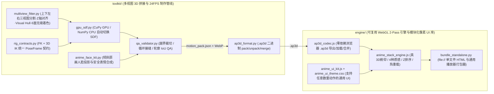

<div align="center">


# Anime Pseudo-3D

**高精细 160 层 × 24 FPS 动漫风伪 3D（精灵堆叠 / Sprite Stacking）制作技能 ＆ 角色无关 WebGL 2-Pass 渲染引擎**

<p>
  
  
  
  
  
  
  
</p>

<p>
  <a href="./README.md">🇯🇵 日本語</a> &nbsp;|&nbsp;
  <a href="./README.en.md">🇺🇸 English</a> &nbsp;|&nbsp;
  <b>🇨🇳 简体中文</b>
</p>

</div>

---

这是一套面向动漫 Q 版角色的**通用伪 3D 生产工具链与 AI Agent 技能库**：在忠实保留原画五官与表情的前提下实现 **360° 丝滑无闪烁旋转**，完整支持 **3D 环绕伙伴相机前后 Z 排序**、**头顶玩梗思考气泡** 以及 **3D 水系／属性粒子攻击特效**，并一键打包为零外部依赖、支持 `file://` 离线双击运行的单文件 HTML。

---

## 效果演示（Live Demos）

### 1. 内置极简示例（[`examples/slime_chibi_demo/`](./examples/slime_chibi_demo/build_demo.py)）
**完全不修改 `engine/` 一行代码**，仅凭声明式 `motion_pack.json` 即可驱动完整场景（一条命令约 1.3 秒构建出单文件 HTML）。

<table>
  <tr>
    <td align="center" width="33%">
      <br />
      <b>360° 无缝旋转</b><br />
      <sub>零角度量化 · 2 倍交错子切片插值</sub>
    </td>
    <td align="center" width="33%">
      <br />
      <b>3D 伙伴前后 Z 排序（BOUNCE）</b><br />
      <sub>立体星型伙伴随视角自动遮挡环绕</sub>
    </td>
    <td align="center" width="33%">
      <br />
      <b>属性斩击与 3D 特效（SPLASH）</b><br />
      <sub>新月斩光＋3D 飞溅水珠＋地面波纹环</sub>
    </td>
  </tr>
</table>

### 2. 四种实时 WebGL 质感着色模式
一键在细腻动漫抗锯齿、方形像素颗粒感、复古硬边像素与手办级柔滑曲面之间实时切换。

<p align="center">
  
</p>

### 3. 真 3D 正交俯仰角（`PITCH 15°–90°`）与 3 套棚拍主题
160 张 2D 切片在 GPU 上连续旋转，采用**真 3D 正交投影（`y = rot.y · sin θ − z · cos θ`）**并叠加 2 倍交错子切片插值（等效 320 层），从平视二次元视角（`20°`）、3/4 等距视角（`48°`）到正上方俯视（`90°`）丝滑过渡且彻底杜绝身体拉伸变形。

<p align="center">
  
</p>

### 4. 本引擎实装代表作（[kuraneko1/deepseek-chan-3d](https://github.com/kuraneko1/deepseek-chan-3d/blob/main/README.zh-CN.md)）
完整收录 **DeepSeek 娘（鲸鱼女仆）** 与 **肌肉版 DeepSeek CEO（力量型·引擎零改动实装）**，各含 9 动作 × 24 FPS 交互式展示。

<table>
  <tr>
    <td align="center" width="25%">
      <a href="https://github.com/kuraneko1/deepseek-chan-3d/blob/main/README.zh-CN.md">
        
      </a><br />
      <b>DeepSeek 娘</b><br />
      <sub>3D 鲸鱼 Logo 玩耍</sub>
    </td>
    <td align="center" width="25%">
      <a href="https://github.com/kuraneko1/deepseek-chan-3d/blob/main/README.zh-CN.md">
        
      </a><br />
      <b>DeepSeek 娘</b><br />
      <sub>深海大漩涡 3D 特效</sub>
    </td>
    <td align="center" width="25%">
      <a href="https://github.com/kuraneko1/deepseek-chan-3d/blob/main/README.zh-CN.md">
        
      </a><br />
      <b>肌肉版 CEO</b><br />
      <sub>双肱二头肌展示</sub>
    </td>
    <td align="center" width="25%">
      <a href="https://github.com/kuraneko1/deepseek-chan-3d/blob/main/README.zh-CN.md">
        
      </a><br />
      <b>肌肉版 CEO</b><br />
      <sub>觉醒气场＋3D 鲸鱼</sub>
    </td>
  </tr>
</table>

---

## 致谢与灵感来源（Credits & Inspiration）

本仓库所采用的精灵堆叠（Sprite Stacking，通过多层 2D 切片构建伪 3D 像素艺术）核心理念与基础制作方法深受以下文章启发：

- **[SpriteCook — Sprite stacking for fake 3D pixel art cars and props](https://www.spritecook.ai/blog/sprite-stacking-pixel-art)**
- 通用精灵堆叠基础技能库：[kuraneko1/sprite-stacking-3d](https://github.com/kuraneko1/sprite-stacking-3d)

---

## 四层解耦架构（多视图 3D 拼接 · 制作工具链 · `.ap3d` 格式 · 可复用 UI 与引擎）



---

## 核心特性

### 1. 可复用 WebGL 2-Pass 引擎与支持任意数量动作的通用像素 UI（`engine/`）
- **模块化 UI 组件库（`AnimeStackEngine` + `AnimeUIKit`）**：将 WebGL 核心（`anime_stack_engine.js`）与 100% 像素纯净 UI 库（`anime_ui_kit.js` + `anime_ui_theme.css`）解耦。既可一行代码 `mountStudioUI()` 挂载完整工作室，也可按需复用单个组件（像素滑块、时间轴、动作架、`.ap3d` 文件读写栏）。
- **不限动画数量（1 ～ ∞ 组动作）**：从单帧静模到 9、18 甚至 50+ 组动作均可自适应——支持动态列数、可滚动像素动作架、可选分类筛选标签（`motion.category`）、`<` / `>`（`[` / `]` 键）步进切换，以及运行时 `engine.addMotions()` / `engine.loadScene()` 热更新。
- **便携自定义二进制格式 `.ap3d`**：零外部 ZIP 依赖的自定义二进制封装（`AP3D` v1，较 base64 缩减约 33% 体积）。浏览器内置 **`LOAD` / `+MOTION` / `EXPORT`** 按钮并支持**直接拖拽 `.ap3d` 到画布加载（按住 `Shift` 拖入可追加合并动作）**。仓库附带轻量通用播放器 [`examples/ap3d_player.html`](./examples/ap3d_player.html)（约 116 KB）。
- **真 3D 正交俯仰与 4 种实时着色模式**：无角度量化连续 0.001° GPU 旋转 ＋ 真 3D 正交俯仰（`y = rot.y · sin θ − z · cos θ`，`PITCH 15°–90°`、默认 `20°`）＋ 2 倍交错子切片（320 层）＋ 4 种质感（`SMOOTH AA` / `PIXEL+AA` / `RETRO PX` / `SILKY 3D`）。
- **多 3D 堆叠深度 Z 排序与声明式特效**：3D 环绕伙伴、头顶气泡与 3D 粒子全部由 JSON 声明驱动。

### 2. 多视图 3D 拼接与动漫制作工具包（`toolkit/`）
- **`multiview_fitter.py`（跨会话 3D 重建保障）**：对生成的 `FRONT / SIDE / BACK / TOP` 多视图使用边界漫水填充抠图（完好保留白色衬衫与眼白），自动测算解剖学 Z 轴标尺、构建 3D Visual Hull 并执行**法线加权 6 方向无缝着色**，同时输出正交轮廓 IoU 对比图（`qa_3d_fit_overlay.png`）确保任何新会话都不会 3D 化失败。
- **`ap3d_format.py`**：Python CLI 一键执行 `.ap3d` 的 `pack`、`unpack`、`inspect` 与 `merge`（无需重烘即可向已有角色追加新动作）。
- **`gpu_sdf.py` / `anime_face_kit.py` / `rig_contracts.py` / `qa_validator.py` / `record_gif.py`**：CuPy GPU / NumPy CPU 自动切换 SDF、倾斜原画人脸投影、FK/IK 统一 `PoseFrame`、越界防护与高质量 GIF 录制。

---

## 目录结构

```text
anime-pseudo-3d/
├── SKILL.md                      # AI Agent 6 阶段端到端标准技能 SOP
├── README.md / README.en.md / README.zh-CN.md
├── assets/                       # 专属图标、演示 GIF、四种质感与真 3D 俯仰对比图
├── engine/
│   ├── anime_stack_engine.js     # 可复用、支持热重载的 WebGL 2-Pass 引擎核心
│   ├── anime_ui_kit.js           # 可复用像素 UI 组件库 (任意数量动作 + .ap3d 读写)
│   ├── anime_ui_theme.css        # 100% 像素纯净主题样式表 (PC + 移动端)
│   ├── ap3d_codec.js             # 零依赖浏览器 .ap3d 二进制编解码器
│   ├── viewer_shell.html         # 简洁模块化 HTML 外壳
│   ├── motion_pack.schema.json   # motion_pack.json 规范 Schema (v1.1)
│   ├── bundle_standalone.py      # 单文件 HTML / .ap3d / 通用播放器打包脚本
│   └── audit_pixel_build.py      # HTML + CSS + JS 像素纯净度静态审计工具
├── toolkit/
│   ├── multiview_fitter.py       # 多视图自动分割、Z轴对齐、Visual Hull、6面无缝着色与 IoU QA
│   ├── ap3d_format.py            # .ap3d 二进制 CLI (pack / unpack / inspect / merge)
│   ├── gpu_sdf.py                # CuPy GPU / NumPy CPU 3D SDF 基础图元
│   ├── anime_face_kit.py         # 倾斜人脸投影与表情合成助手
│   ├── rig_contracts.py          # FK/IK 统一 PoseFrame 与周期动画曲线
│   ├── pixel_fx_kit.py           # 像素特效精灵与 16x16 UI 图标
│   ├── qa_validator.py           # 烘焙前数学 QA + 越界防护 + 3D QA 检视表
│   └── record_gif.py             # Playwright WebGL → FFmpeg 优化 GIF 录制器
├── examples/
│   ├── ap3d_player.html          # 轻量通用拖拽式 .ap3d 播放器 (约 116 KB)
│   └── slime_chibi_demo/         # 端到端极简示例 (单文件 HTML + slime-chibi.ap3d)
└── references/
    ├── multiview_3d_reconstruction_guide.md  # 多视图生图提示词与无缝 3D 拼接指南
    ├── anime_model_guide.md                  # 动漫风 3D 建模设计指南
    ├── animation_24fps_guide.md              # 24 FPS 骨骼绑定、IK 与节奏指南
    └── webgl_engine_guide.md                 # WebGL 引擎、AnimeUIKit 与 .ap3d API 手册
```

---

## 快速开始

### 1. 安装为 AI Agent 技能（Antigravity / `~/.agents/skills`）
```bash
git clone https://github.com/kuraneko1/anime-pseudo-3d.git ~/projects/anime-pseudo-3d
ln -s ~/projects/anime-pseudo-3d ~/.agents/skills/anime-pseudo-3d
```

### 2. 构建极简示例（单文件 HTML ＋ `.ap3d`）并用通用播放器体验
```bash
cd ~/projects/anime-pseudo-3d
python3 examples/slime_chibi_demo/build_demo.py
# -> 直接打开 examples/slime_chibi_demo/build/slime-chibi-standalone.html，
#    或打开 examples/ap3d_player.html 并将 slime-chibi.ap3d 拖入画面即可播放！
```

### 3. 像素审计、`.ap3d` 打包合并与单文件 HTML 输出
```bash
python3 engine/audit_pixel_build.py \
  --html engine/viewer_shell.html \
  --css engine/anime_ui_theme.css \
  --js engine/ap3d_codec.js engine/anime_ui_kit.js engine/anime_stack_engine.js

python3 engine/bundle_standalone.py \
  --html engine/viewer_shell.html \
  --js engine/anime_stack_engine.js \
  --pack your_char/motion_pack.json \
  --assets-root your_char \
  --export-ap3d dist/your-char.ap3d \
  --out dist/your-char-standalone.html

# 向现有 .ap3d 追加新动作（无需重新烘焙）
python3 toolkit/ap3d_format.py merge \
  --base dist/your-char.ap3d \
  --extra dist/more-motions.ap3d \
  --out dist/your-char-expanded.ap3d
```

---

## 运行依赖
- **Python 3.10+**（`numpy`、`pillow`；若配备 NVIDIA GPU 将自动启用 `cupy` 加速烘焙）
- **浏览器自动化验证 / GIF 录制（可选）**：`playwright` + Chromium/Chrome + `ffmpeg`
- **打包生成的单文件 HTML**：零依赖（任意支持 WebGL 的现代浏览器均可通过 `file://` 直接运行）

---

## License

[MIT License](./LICENSE)
