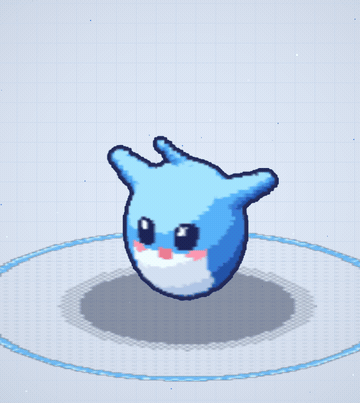
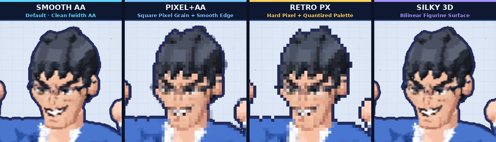
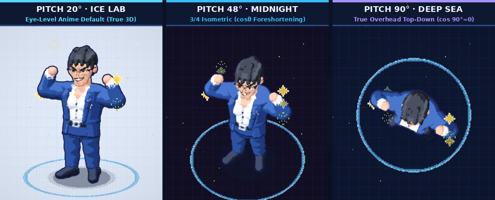
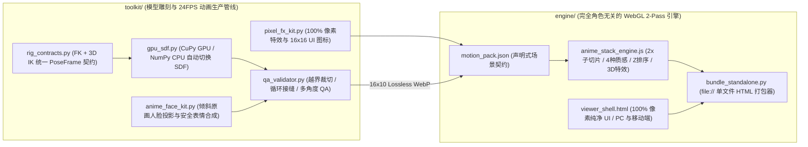

<div align="center">


# Anime Pseudo-3D

**高精细 160 层 × 24 FPS 动漫风伪 3D（精灵堆叠 / Sprite Stacking）制作技能 ＆ 角色无关 WebGL 2-Pass 渲染引擎**

<p>
  
  
  
  
  
  
  
</p>

<p>
  <a href="./README.md">🇯🇵 日本語</a> &nbsp;|&nbsp;
  <a href="./README.en.md">🇺🇸 English</a> &nbsp;|&nbsp;
  <b>🇨🇳 简体中文</b>
</p>

</div>

---

这是一套面向动漫 Q 版角色的**通用伪 3D 生产工具链与 AI Agent 技能库**：在忠实保留原画五官与表情的前提下实现 **360° 丝滑无闪烁旋转**，完整支持 **3D 环绕伙伴相机前后 Z 排序**、**头顶玩梗思考气泡** 以及 **3D 水系／属性粒子攻击特效**，并一键打包为零外部依赖、支持 `file://` 离线双击运行的单文件 HTML。

---

## 效果演示（Live Demos）

### 1. 内置极简示例（[`examples/slime_chibi_demo/`](./examples/slime_chibi_demo/build_demo.py)）
**完全不修改 `engine/` 一行代码**，仅凭声明式 `motion_pack.json` 即可驱动完整场景（一条命令约 1.3 秒构建出单文件 HTML）。

<table>
  <tr>
    <td align="center" width="33%">
      <br />
      <b>360° 无缝旋转</b><br />
      <sub>零角度量化 · 2 倍交错子切片插值</sub>
    </td>
    <td align="center" width="33%">
      <br />
      <b>3D 伙伴前后 Z 排序（BOUNCE）</b><br />
      <sub>立体星型伙伴随视角自动遮挡环绕</sub>
    </td>
    <td align="center" width="33%">
      <br />
      <b>属性斩击与 3D 特效（SPLASH）</b><br />
      <sub>新月斩光＋3D 飞溅水珠＋地面波纹环</sub>
    </td>
  </tr>
</table>

### 2. 四种实时 WebGL 质感着色模式
一键在细腻动漫抗锯齿、方形像素颗粒感、复古硬边像素与手办级柔滑曲面之间实时切换。

<p align="center">
  
</p>

### 3. 真 3D 正交俯仰角（`PITCH 15°–90°`）与 3 套棚拍主题
160 张 2D 切片在 GPU 上连续旋转，采用**真 3D 正交投影（`y = rot.y · sin θ − z · cos θ`）**并叠加 2 倍交错子切片插值（等效 320 层），从平视二次元视角（`20°`）、3/4 等距视角（`48°`）到正上方俯视（`90°`）丝滑过渡且彻底杜绝身体拉伸变形。

<p align="center">
  
</p>

### 4. 本引擎实装代表作（[kuraneko1/deepseek-chan-3d](https://github.com/kuraneko1/deepseek-chan-3d/blob/main/README.zh-CN.md)）
完整收录 **DeepSeek 娘（鲸鱼女仆）** 与 **肌肉版 DeepSeek CEO（力量型·引擎零改动实装）**，各含 9 动作 × 24 FPS 交互式展示。

<table>
  <tr>
    <td align="center" width="25%">
      <a href="https://github.com/kuraneko1/deepseek-chan-3d/blob/main/README.zh-CN.md">
        
      </a><br />
      <b>DeepSeek 娘</b><br />
      <sub>3D 鲸鱼 Logo 玩耍</sub>
    </td>
    <td align="center" width="25%">
      <a href="https://github.com/kuraneko1/deepseek-chan-3d/blob/main/README.zh-CN.md">
        
      </a><br />
      <b>DeepSeek 娘</b><br />
      <sub>深海大漩涡 3D 特效</sub>
    </td>
    <td align="center" width="25%">
      <a href="https://github.com/kuraneko1/deepseek-chan-3d/blob/main/README.zh-CN.md">
        
      </a><br />
      <b>肌肉版 CEO</b><br />
      <sub>双肱二头肌展示</sub>
    </td>
    <td align="center" width="25%">
      <a href="https://github.com/kuraneko1/deepseek-chan-3d/blob/main/README.zh-CN.md">
        
      </a><br />
      <b>肌肉版 CEO</b><br />
      <sub>觉醒气场＋3D 鲸鱼</sub>
    </td>
  </tr>
</table>

---

## 致谢与灵感来源（Credits & Inspiration）

本仓库所采用的精灵堆叠（Sprite Stacking，通过多层 2D 切片构建伪 3D 像素艺术）核心理念与基础制作方法深受以下文章启发：

- **[SpriteCook — Sprite stacking for fake 3D pixel art cars and props](https://www.spritecook.ai/blog/sprite-stacking-pixel-art)**
- 通用精灵堆叠基础技能库：[kuraneko1/sprite-stacking-3d](https://github.com/kuraneko1/sprite-stacking-3d)

---

## 解耦架构（模型制作工具链与 WebGL 引擎分离）



---

## 核心特性

### 1. 角色无关的数据驱动 WebGL 2-Pass 渲染引擎（`engine/`）
- **零闪烁顺滑管线**：无角度量化的连续 0.001° GPU 旋转 ＋ 2 倍交错子切片插值（等效 320 层）＋ 2 倍超采样离屏 FBO。
- **4 种实时质感着色模式**：
  - `SMOOTH AA`（默认）：不透明纹素归一化 ＋ `fwidth` 亚像素边缘抗锯齿（杜绝黑边渗色）。
  - `PIXEL+AA`：保留方形像素颗粒感并叠加顺滑边缘抗锯齿（支持自由调节 `DOT SIZE`）。
  - `RETRO PX`：经典硬边像素 ＋ 四向阶梯描边 ＋ 复古色阶量化。
  - `SILKY 3D`：双线性柔滑手办质感。
- **二次元出片默认参数与真 3D 俯仰投影**：开箱即设为 `PITCH 20°`（`sin θ ≈ 0.35`，配精确 `cos θ` 纵轴透视缩短）、`ICE LAB` 明亮棚拍背景与 `SMOOTH AA`。
- **多 3D 堆叠前后深度 Z 排序**：自动依据当前相机角度将环绕角色的 3D 伙伴模型（独立 FBO）与 3D 粒子精准排序至角色身前或身后。
- **声明式 `motion_pack.json`**：动作列表、3D 伙伴环绕轨道、头顶思考气泡、3D 粒子发射器（`sparkle_perimeter` / `orbit_trail` / `burst_above` / `forward_slash_fan` / `helix_vortex` / `floor_wave_rings`）全部通过 JSON 配置，无需改动引擎代码。
- **24 帧「子弹时间」时间轴**：支持暂停并拖动任意单帧，同时 360° 环绕观察刀光、冲击波与 3D 伙伴细节。

### 2. 动漫风 3D 制作工具包（`toolkit/`）
- **`gpu_sdf.py`**：自动检测 CuPy（NVIDIA GPU）并在无卡环境无缝回退至 NumPy CPU 的 3D SDF 雕刻与三阶赛璐璐着色库。
- **`anime_face_kit.py`**：从原画提取面部、斜向贴合投影，以及彻底杜绝暖色皮肤光晕瑕疵的表情绘制助手。
- **`rig_contracts.py`**：融合 FK 关节旋转与 3D 坐标 IK 目标的统一 `PoseFrame` 契约、体积守恒挤压拉伸 `sx` 与滞后弹性周期曲线。
- **`qa_validator.py` & `record_gif.py`**：循环首尾连续性数学校验、全帧边界越界检测、多角度 3D QA 检视表导出，以及基于 Playwright + FFmpeg 的高画质调色板 GIF 录制器。

---

## 目录结构

```text
anime-pseudo-3d/
├── SKILL.md                      # AI Agent 技能定义 (兼容 Antigravity / OpenClaude)
├── README.md / README.en.md / README.zh-CN.md
├── assets/                       # 专属图标、演示 GIF、四种质感与切片展开对比图
├── engine/
│   ├── anime_stack_engine.js     # 角色无关 WebGL 2-Pass 引擎核心
│   ├── viewer_shell.html         # 100% 像素纯净 UI 外壳 (PC + 移动端)
│   ├── motion_pack.schema.json   # motion_pack.json 规范 Schema
│   ├── bundle_standalone.py      # 离线 file:// 单文件 HTML 打包脚本
│   └── audit_pixel_build.py      # 像素纯净度静态审计工具
├── toolkit/
│   ├── gpu_sdf.py                # CuPy GPU / NumPy CPU 3D SDF 基础图元
│   ├── anime_face_kit.py         # 倾斜人脸投影与表情合成助手
│   ├── rig_contracts.py          # FK/IK 统一 PoseFrame 与周期动画曲线
│   ├── pixel_fx_kit.py           # 像素特效精灵 (水滴/气泡/斩光/波纹) 与 16x16 图标
│   ├── qa_validator.py           # 烘焙前数学 QA + 越界防护 + 3D QA 检视表
│   └── record_gif.py             # Playwright WebGL → FFmpeg 优化 GIF 录制器
├── examples/
│   └── slime_chibi_demo/         # 端到端极简示例 (Q版水精灵 + 3D 星型伙伴 + 水特效)
└── references/
    ├── anime_model_guide.md      # 动漫风 3D 建模设计指南
    ├── animation_24fps_guide.md  # 24 FPS 骨骼绑定、IK 与节奏指南
    └── webgl_engine_guide.md     # WebGL 引擎与 motion_pack.json 参考手册
```

---

## 快速开始

### 1. 安装为 AI Agent 技能（Antigravity / `~/.agents/skills`）
```bash
git clone https://github.com/kuraneko1/anime-pseudo-3d.git ~/projects/anime-pseudo-3d
ln -s ~/projects/anime-pseudo-3d ~/.agents/skills/anime-pseudo-3d
```

### 2. 构建并运行极简示例
```bash
cd ~/projects/anime-pseudo-3d
python3 examples/slime_chibi_demo/build_demo.py
# -> 用浏览器直接打开 examples/slime_chibi_demo/build/slime-chibi-standalone.html 即可体验！
```

### 3. 像素纯净度审计与单文件 HTML 打包
```bash
python3 engine/audit_pixel_build.py \
  --html engine/viewer_shell.html \
  --js engine/anime_stack_engine.js

python3 engine/bundle_standalone.py \
  --html engine/viewer_shell.html \
  --js engine/anime_stack_engine.js \
  --pack your_char/motion_pack.json \
  --assets-root your_char \
  --out dist/your-char-standalone.html
```

---

## 运行依赖
- **Python 3.10+**（`numpy`、`pillow`；若配备 NVIDIA GPU 将自动启用 `cupy` 加速烘焙）
- **浏览器自动化验证 / GIF 录制（可选）**：`playwright` + Chromium/Chrome + `ffmpeg`
- **打包生成的单文件 HTML**：零依赖（任意支持 WebGL 的现代浏览器均可通过 `file://` 直接运行）

---

## License

[MIT License](./LICENSE)
